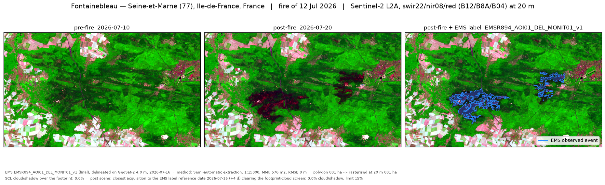

# burned-area-s2

**Status, 20 October 2026.** Reproduced bit for bit from a clean clone
([`docs/reproduction.md`](docs/reproduction.md)). Not done yet: spread over
several seeds, error maps, a pre-registered hold-out event.

Burned-area mapping from Sentinel-2 pre/post pairs at 20 m. Trained on one
Copernicus EMS fire (Saumos, pine). Tested on two unseen ones: Biscarrosse
(pine) and Fontainebleau (broadleaf). Three scores — dNBR, a per-pixel
gradient-boosting model (GB) and a U-Net — each under three threshold regimes.

## TL;DR

- **A per-pixel model matches the U-Net.** GB, which sees no neighbouring pixel,
  scores IoU 0.881 vs 0.863 on held-out Saumos and 0.561 vs 0.571 on Biscarrosse.
- **Transfer fails on the threshold, not the score.** On Fontainebleau the dNBR
  ranks pixels well (AP 0.839), but its frozen threshold gives IoU 0.192, against
  0.624 for the best possible threshold.
- **A threshold set without labels repairs it.** GB + Otsu reaches IoU 0.696 on
  Fontainebleau, within 0.005 of its own oracle, with no test label used.
- **Caveat:** each model was trained once (one seed), and Otsu was chosen after
  seeing the test events. See [Limits](#limits).

**Operational message:** on a new territory at 20 m, a frugal per-pixel model
with a label-free threshold is the strongest deployable option measured here.



## Results

IoU per threshold regime, and AP, which needs no threshold. Source:
[`outputs/regimes.json`](outputs/regimes.json). The full grid, with the GMM
estimator and a change-only GB ablation, is in
[`outputs/regimes.md`](outputs/regimes.md).

| Event | Method | frozen | Otsu | *oracle* | AP |
|---|---|---|---|---|---|
| saumos | dNBR | 0.702 | 0.811 | *0.812* | 0.906 |
| saumos | GB pixel | 0.881 | 0.797 | *0.893* | 0.981 |
| saumos | U-Net | 0.863 | 0.857 | *0.875* | 0.976 |
| biscarrosse | dNBR | 0.481 | 0.501 | *0.526* | 0.641 |
| biscarrosse | GB pixel | 0.561 | 0.558 | *0.568* | 0.675 |
| biscarrosse | U-Net | 0.571 | 0.533 | *0.571* | 0.702 |
| fontainebleau | dNBR | 0.192 | 0.466 | *0.624* | 0.839 |
| fontainebleau | GB pixel | 0.487 | 0.696 | *0.701* | 0.887 |
| fontainebleau | U-Net | 0.556 | 0.599 | *0.621* | 0.830 |

- **Frozen:** F1-optimal on Saumos calibration blocks, frozen before test, with
  the same procedure for every method.
- **Otsu:** read from the target's own score histogram. Uses no labels, so it is
  deployable.
- **Oracle:** fitted on the target's labels. It is an instrument, not a result.

Saumos rows are its held-out test blocks.
[`outputs/results.md`](outputs/results.md) is the historical two-method table
(no GB, no U-Net oracle). Its numbers agree with this one.

## Key findings

**At 20 m the information is mostly spectral.** GB sees eight channels per
pixel and no context. On pine it matches or beats the U-Net. On Fontainebleau it
ranks pixels better than the U-Net (AP 0.887 vs 0.830). Under the frozen
threshold, though, the U-Net transfers better there (0.556 vs 0.487).

**The main transfer failure is the threshold.** On Fontainebleau the dNBR's AP
(0.839) is close to its in-domain value, yet the frozen threshold misses 80% of
the burned area. Every method gains more from re-thresholding there than from
changing the score.

**A label-free threshold on a per-pixel score is the best deployable option**
on the unseen biome: GB + Otsu at 0.696 beats the dNBR oracle (0.624). It is
not free. Where the frozen threshold was already right, Otsu costs IoU (Saumos
GB 0.881 → 0.797), and the GMM alternative fails everywhere.

**Context keeps an edge in one place only:** ranking on Biscarrosse (AP 0.702
vs 0.675). The hypothesis is clearcuts — rectangular, sharp-edged, dNBR-like —
which only a receptive field can reject. The numbers are *consistent with* it;
it is not *verified* until the error maps exist. We expect context to matter
more at very high resolution. That is a hypothesis, not a result.

## Limits

- **One seed per model.** Gaps of 0.01–0.03 between GB and U-Net are not
  interpretable until the spread over 5 seeds is measured.
- **Two transfer events, no confidence intervals.** The bootstrap resamples
  ~17.5 km blocks that contain burn, and no domain here has the 4 it needs.
  Intervals are declared missing rather than faked
  ([`outputs/results.json`](outputs/results.json)).
- **Otsu was chosen after seeing the test events.** Both estimators are
  reported. A pre-registered hold-out event is the planned answer.
- **EMS labels are semi-automatic,** so part of any score is agreement with how
  the label was drawn. The floor is the dNBR's AP against each label: 0.906,
  0.641 and 0.839.
- **Calibration blocks do double duty** (epoch selection and threshold), so the
  F1 the threshold reaches there is mildly optimistic. No test pixel is used for
  either.
- **ImageNet encoder on SWIR bands:** kept as a regularising initialisation for
  70 tiles. Not ablated.

## FAQ

- **Why 20 m?** B8A/B11/B12 are native at 20 m, and the EMS polygons are
  digitised at 1:15 000. At 10 m a per-pixel score would mostly measure the
  analyst's hand.
- **Why these events, and so few?** Each needs a final EMS delineation and a
  clear Sentinel-2 pair. Biscarrosse is a size control (same biome as Saumos,
  same size as Fontainebleau), so a size effect is not mistaken for a biome
  effect.
- **Minority class?** The loss is BCE + Dice. The threshold is F1-optimal on
  calibration blocks with 2.2% prevalence. AP is reported without a threshold,
  and global accuracy is refused by the code.
- **Cost?** U-Net (24.5 M parameters, 40 epochs, 70 tiles): about 10 min on 16
  CPU threads ([`outputs/training_e1.json`](outputs/training_e1.json)). The full
  chain takes about 25 min on CPU ([`docs/reproduction.md`](docs/reproduction.md)).
  No GPU.

## Method

- **Split.** By event. Inside Saumos, by ~17.5 km spatial blocks
  (train / calibration / test), with a 1 km buffer that belongs to no role
  ([map](outputs/split_saumos.png)).
- **Test footprint.** The EMS area of interest + 2 km. Every pixel is scored,
  and no negative tile is filtered out.
- **Validity mask.** One SCL validity mask on both dates, shared by every method.
  The Saumos post-fire scene is 27% clouded, which costs 8 293 ha of scar.
- **Inputs.** B04/B8A/B11/B12 × 2 dates = 8 channels. The U-Net uses a ResNet-34
  encoder with D4 augmentation, and its epoch is chosen by AP on the calibration
  blocks.
- **Tests.** `tests/` fails loudly on leaks: a test event in training or
  calibration, a deployable oracle, unequal pixel sets, a dropped estimator.

## Running it

```bash
conda env create -f environment.yml && conda activate burned-area-s2
python -m src.data.ems                       # EMS provenance + label rasters
python -m src.data.stack                     # 8-channel stacks + validity masks
python -m src.eval.blocks                    # spatial blocks and roles
python -m src.eval.dnbr && python -m src.eval.baseline
python -m src.data.tiles && python -m src.model.dataset
python -m src.model.train --experiment E1    # ~10 min, CPU
python -m src.model.predict --experiment E1 && python -m src.model.evaluate
python -m src.eval.pixel_model               # GB per-pixel control
python -m src.eval.regimes                   # methods x regimes grid
python -m src.eval.check_readme              # README numbers == outputs/*.json
pytest -q -rs
```

All settings, events and dates live in `config.yaml`. No credentials are
needed: the imagery is public COGs from Element 84 STAC.

## Next steps

- **Sentinel-1:** fill cloud gaps (8 293 ha lost on Saumos).
- **Time series:** separate burns from clearcuts by when the change happens.
- **Very high resolution:** where spatial context should matter, and where that
  could be tested.

## Licence

MIT. Copernicus EMS products and Sentinel-2 data under their own terms.
