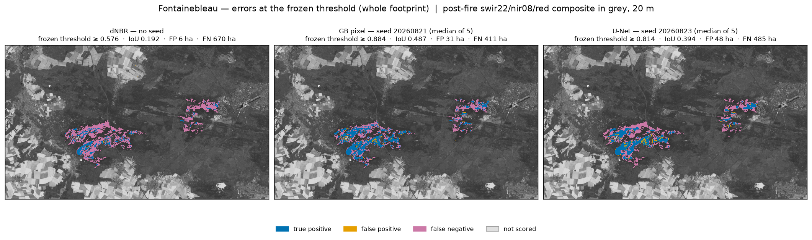

# burned-area-s2

**Status, 21 October 2026.** Reproduced bit for bit from a clean clone
([`docs/reproduction.md`](docs/reproduction.md)). Every trained model is now
run on 5 seeds, and error maps show where each method fails. Not done yet: a
pre-registered hold-out event.

Burned-area mapping from Sentinel-2 pre/post pairs at 20 m. Trained on one
Copernicus EMS fire (Saumos, pine). Tested on two unseen ones: Biscarrosse
(pine) and Fontainebleau (broadleaf). Three scores — dNBR, a per-pixel
gradient-boosting model (GB) and a U-Net — each under three threshold regimes.

## TL;DR

- **A per-pixel model matches the U-Net.** GB, which sees no neighbouring pixel,
  scores IoU 0.887 ± 0.004 vs 0.865 ± 0.006 on held-out Saumos (GB ahead beyond
  seed noise), and 0.563 vs 0.557 on Biscarrosse (indistinguishable).
- **Transfer fails on the threshold, not the score.** On Fontainebleau the dNBR
  ranks pixels well (AP 0.839), but its frozen threshold gives IoU 0.192, against
  0.624 for the best possible threshold.
- **A threshold set without labels repairs it.** GB + Otsu reaches IoU
  0.697 ± 0.006 on Fontainebleau, within 0.003 of its own oracle, with no test
  label used.
- **Caveat:** ± is the sd over 5 training seeds. That is a floor on the
  uncertainty, not a confidence interval. Otsu was chosen after seeing the test
  events. See [Limits](#limits).

**Operational message:** on a new territory at 20 m, a frugal per-pixel model
with a label-free threshold is the strongest deployable option measured here.



## Results

IoU per threshold regime, and AP, which needs no threshold. GB and U-Net cells
are mean ± sd over 5 seeds. The dNBR has no seed. Source:
[`outputs/regimes.json`](outputs/regimes.json). The full grid, with min–max per
cell, the GMM estimator, a change-only GB ablation and every gap read against
the seed spread, is in [`outputs/regimes.md`](outputs/regimes.md).

| Event | Method | frozen | Otsu | *oracle* | AP |
|---|---|---|---|---|---|
| saumos | dNBR | 0.702 | 0.811 | *0.812* | 0.906 |
| saumos | GB pixel | 0.887 ± 0.004 | 0.846 ± 0.028 | *0.902 ± 0.006* | 0.983 ± 0.002 |
| saumos | U-Net | 0.865 ± 0.006 | 0.841 ± 0.019 | *0.870 ± 0.006* | 0.969 ± 0.013 |
| biscarrosse | dNBR | 0.481 | 0.501 | *0.526* | 0.641 |
| biscarrosse | GB pixel | 0.563 ± 0.001 | 0.559 ± 0.001 | *0.569 ± 0.001* | 0.678 ± 0.004 |
| biscarrosse | U-Net | 0.557 ± 0.009 | 0.529 ± 0.009 | *0.559 ± 0.009* | 0.685 ± 0.011 |
| fontainebleau | dNBR | 0.192 | 0.466 | *0.624* | 0.839 |
| fontainebleau | GB pixel | 0.500 ± 0.011 | 0.697 ± 0.006 | *0.700 ± 0.004* | 0.885 ± 0.002 |
| fontainebleau | U-Net | 0.489 ± 0.068 | 0.611 ± 0.030 | *0.629 ± 0.018* | 0.828 ± 0.015 |

- **Frozen:** F1-optimal on Saumos calibration blocks, frozen before test, with
  the same procedure for every method.
- **Otsu:** read from the target's own score histogram. Uses no labels, so it is
  deployable.
- **Oracle:** fitted on the target's labels. It is an instrument, not a result.

- **A gap counts** only when the two methods' seed ranges do not overlap. The
  rule was fixed before the runs ([`docs/decisions.md`](docs/decisions.md)).

Saumos rows are its held-out test blocks.
[`outputs/results.md`](outputs/results.md) is the historical two-method table:
the original single run (seed 20260821), with no GB and no U-Net oracle.

## Key findings

**At 20 m the information is mostly spectral.** GB sees eight channels per
pixel and no context. It beats the U-Net on held-out Saumos and is
indistinguishable from it on Biscarrosse. On Fontainebleau it ranks pixels
better (AP 0.885 vs 0.828, separated). Under the frozen threshold the two are
indistinguishable there (0.500 vs 0.489). The U-Net's seeds span 0.394–0.556.

**The main transfer failure is the threshold.** On Fontainebleau the dNBR's AP
(0.839) is close to its in-domain value, yet the frozen threshold misses 80% of
the burned area. Every method gains more from re-thresholding there than from
changing the score.

**A label-free threshold on a per-pixel score is the best deployable option**
on the unseen biome. GB + Otsu at 0.697 beats the dNBR oracle (0.624) and
U-Net + Otsu (0.611), both beyond seed noise. It is not free. Where the frozen
threshold was already right, Otsu costs IoU (Saumos GB 0.887 → 0.846), and the
GMM alternative fails everywhere.

**No measurable edge for context at 20 m.** The single run showed one: ranking
on Biscarrosse, AP 0.702 vs 0.675. That run was the U-Net's best seed there.
Over 5 seeds it is 0.685 ± 0.011 vs 0.678 ± 0.004, which is indistinguishable.
The same run was also the U-Net's best seed on Fontainebleau under the frozen
threshold. The clearcut hypothesis built on that gap now has no gap to explain,
so its test was dropped before any map existed rather than run in search of a
story ([decisions](docs/decisions.md)). It stays unverified. We expect context to
matter more at very high resolution. That is a hypothesis, not a result.

**Where the errors are** ([Saumos](outputs/errors_saumos.png),
[Biscarrosse](outputs/errors_biscarrosse.png) and its
[zoom](outputs/errors_biscarrosse_zoom.png),
[Fontainebleau](outputs/errors_fontainebleau.png); frozen threshold, median
calibration seed). On Fontainebleau every method's error is mostly missed burn,
the threshold failure the grid measures. On Biscarrosse the largest false
positive is one contiguous patch that all three methods call burned, outside the
EMS perimeter. That is consistent with burn the label does not contain (the
post scene is 7 days after the label's imagery), not verified. The drawn U-Net
seed happens to be its worst on Fontainebleau, and its maps show tile seams.

## Limits

- **Seed spread is a floor, not an interval.** It measures training noise on
  one training event, not variance across events. GB's spread is narrow partly
  by construction: its 1.41 M training pixels are under the subsample cap, so
  its seed moves only the early-stopping split
  ([`outputs/pixel_model.json`](outputs/pixel_model.json)).
- **Two transfer events, no confidence intervals.** The bootstrap resamples
  ~17.5 km blocks that contain burn, and no domain here has the 4 it needs.
  Intervals are declared missing rather than faked
  ([`outputs/results.json`](outputs/results.json)).
- **Otsu was chosen after seeing the test events.** Both estimators are
  reported. A pre-registered hold-out event is the planned answer.
- **EMS labels are semi-automatic,** so part of any score is agreement with how
  the label was drawn. The floor is the dNBR's AP against each label: 0.906,
  0.641 and 0.839.
- **Calibration blocks do double duty** (epoch selection and threshold), so the
  F1 the threshold reaches there is mildly optimistic. No test pixel is used for
  either.
- **ImageNet encoder on SWIR bands:** kept as a regularising initialisation for
  70 tiles. Not ablated.

## Method

- **Split.** By event. Inside Saumos, by ~17.5 km spatial blocks
  (train / calibration / test), with a 1 km buffer that belongs to no role
  ([map](outputs/split_saumos.png)).
- **Test footprint.** The EMS area of interest + 2 km. Every pixel is scored,
  and no negative tile is filtered out.
- **Validity mask.** One SCL validity mask on both dates, shared by every method.
  The Saumos post-fire scene is 27% clouded, which costs 8 293 ha of scar.
- **Inputs.** B04/B8A/B11/B12 × 2 dates = 8 channels. The U-Net uses a ResNet-34
  encoder with D4 augmentation, and its epoch is chosen by AP on the calibration
  blocks.
- **Tests.** `tests/` fails loudly on leaks: a test event in training or
  calibration, a deployable oracle, unequal pixel sets, a dropped estimator.

## Running it

```bash
conda env create -f environment.yml && conda activate burned-area-s2
python -m src.data.ems                       # EMS provenance + label rasters
python -m src.data.stack                     # 8-channel stacks + validity masks
python -m src.eval.blocks                    # spatial blocks and roles
python -m src.eval.dnbr && python -m src.eval.baseline
python -m src.data.tiles && python -m src.model.dataset
python -m src.model.train --experiment E1    # ~11 min per seed, 5 seeds, CPU
python -m src.model.predict --experiment E1 && python -m src.model.evaluate
python -m src.eval.pixel_model               # GB per-pixel control
python -m src.eval.regimes                   # methods x regimes grid
python -m src.viz.errors                     # TP / FP / FN maps, median seed
python -m src.eval.check_readme              # README numbers == outputs/*.json
pytest -q -rs
```

All settings, events and dates live in `config.yaml`. No credentials are
needed: the imagery is public COGs from Element 84 STAC.

## Next steps

- **Sentinel-1:** fill cloud gaps (8 293 ha lost on Saumos).
- **Time series:** separate burns from clearcuts by when the change happens.
- **Very high resolution:** where spatial context should matter, and where that
  could be tested.

## Licence

MIT. Copernicus EMS products and Sentinel-2 data under their own terms.
